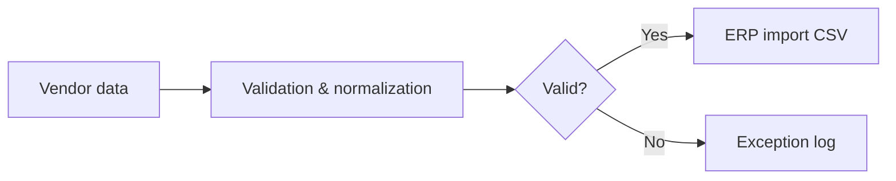

# Vendor Pricing Automation — Portfolio Demonstration

A **sanitized, independent demonstration** inspired by my work automating supplier pricing workflows. My professional project involved 300+ vendors and reduced manual reconciliation by an estimated 15+ hours per week. **This repository is not the employer's original code or data.**

## What this demo does
- Loads fictional vendor records from CSV
- Normalizes SKUs and prices; flags duplicate or invalid records
- Selects the latest valid price per vendor / SKU
- Writes an ERP-ready CSV and an exceptions report
- Includes unit tests and GitHub Actions CI

## Run
```bash
python src/sync.py --input data/sample_prices.csv --output out/prices.csv --exceptions out/exceptions.csv
python -m unittest discover -s tests -v
```

## Architecture


## Future improvements
Scheduled ingestion, vendor API adapters, retries, incremental caching, audit events and dashboard.

## Ethical note
All sample datasets are fictional. No employer credentials, endpoints, customer records, vendor agreements or proprietary source code are included.
